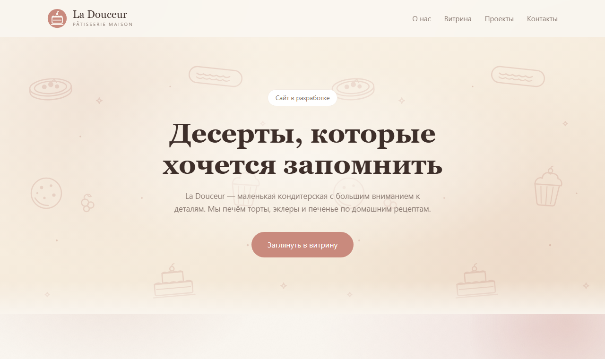

# La Douceur — сайт кондитерской

Лендинг для маленькой кондитерской ручной работы: торты, эклеры и печенье.
Тёплая «пергаментная» эстетика, кастомный SVG-логотип, узор из кондитерских
иллюстраций и мягкие анимации. Полностью отзывчивая вёрстка без сборщиков.



## Возможности

- адаптивный лендинг для десктопа и мобильных устройств
- кастомный SVG-логотип и favicon
- hero-фон «пергамент» с бесшовным узором из линейных иллюстраций
- слайдер «Наши проекты» на чистом JavaScript
- анимации появления секций с поддержкой `prefers-reduced-motion`

## Стек

Python, Flask, Jinja2, HTML, CSS, ванильный JavaScript. На фронтенде — без
зависимостей и сборки.

## Запуск

```bash
python -m venv .venv
.venv\Scripts\activate        # Windows
pip install -r requirements.txt
python run.py
```

Сайт откроется на http://127.0.0.1:5000/.
